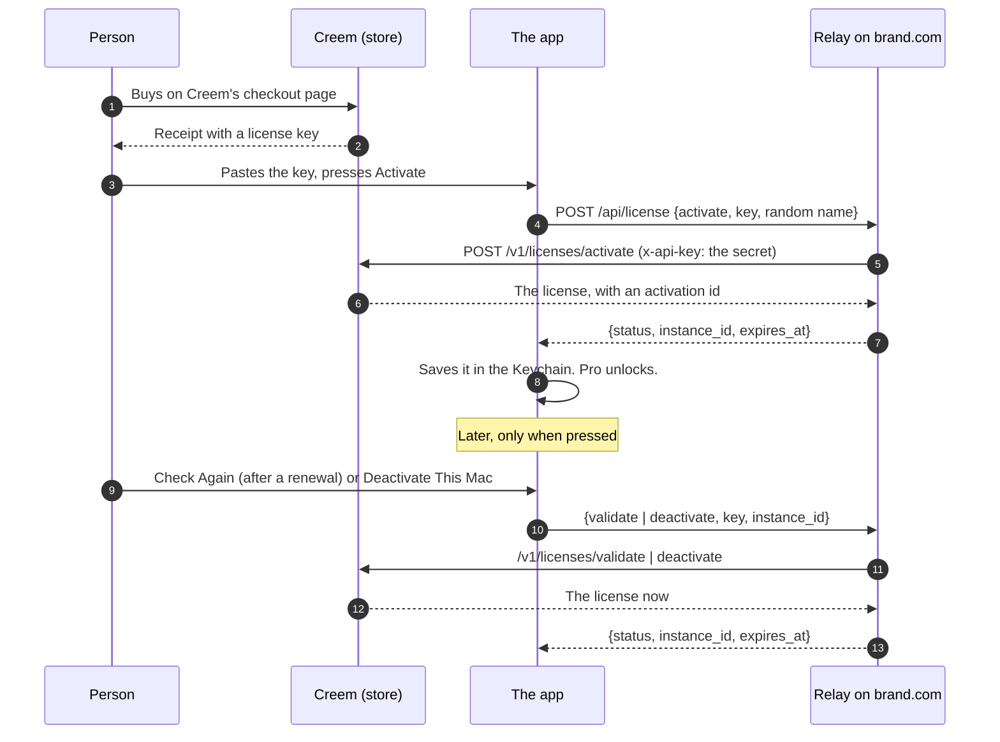

# Selling a direct-download app through Creem: the playbook

How NetRelish sells Pro outside the Mac App Store, written so any Shepdesign product can
copy it. NetRelish is the worked example; every name that changes per brand is in the
table in section 8.

| | |
|---|---|
| Written | Nov 21, 2026 |
| Read from | `Shepdesign-LLC/NetRelish` at `becb8ea` (the app) and `Shepdesign-LLC/netrelish-site` at `1fdac22` (the relay) |
| Decisions it rests on | ADR 0027 (Creem, through a relay), ADR 0031 (previews stay unlocked), ADR 0032 (what the App Store build declares) |
| State today | The app side and the relay are built and tested. Nothing is on sale yet: section 11 lists what is left |

Creem's own behavior (sections 2, 7 and 9) comes from Creem's public docs as search
results showed them. docs.creem.io could not be opened directly when this was written, so
confirm those details in test mode before selling. Sources are at the end.

---

## 1. The idea in five lines

1. **Creem is the store.** It takes the money, handles sales tax as merchant of record,
   and issues a license key with each purchase.
2. **The app never talks to Creem.** Creem's license API needs the store's secret key on
   every call. A key inside an app can be pulled out of it, and that key opens the whole
   store, customers included.
3. **A small relay on the product's own site holds the secret key.** The app sends it a
   license key and a random name for this computer. The relay asks Creem and passes back
   three fields.
4. **The app only asks when a person presses a button.** Activate, Check Again, or
   Deactivate. Never at launch, never on a timer.
5. **The answer lives in the Keychain on that one computer.** Pro is decided from it
   locally, including a yearly license running out, with no further call.

## 2. The whole flow



Creem's three license calls, as its docs list them:

| Call | Path | Body |
|---|---|---|
| Activate | `POST /v1/licenses/activate` | `key`, `instance_name` |
| Validate | `POST /v1/licenses/validate` | `key`, `instance_id` |
| Deactivate | `POST /v1/licenses/deactivate` | `key`, `instance_id` |

Live host `https://api.creem.io`, test host `https://test-api.creem.io`. The secret goes
in the `x-api-key` header. Test and live are separate stores with separate keys and
separate data. A license's status is one of `active`, `inactive`, `expired`, `disabled`.

## 3. The four parts, and who owns each

| Part | Where it lives | What it does | Who sets it up |
|---|---|---|---|
| **The store** | Creem dashboard | Products, prices, license keys, receipts, refunds, tax | Ryan |
| **The relay** | The site's repo, one server route (`/api/license`) | Holds the secret key. Checks the request, rate-limits it, asks Creem, cuts the answer down | Built once; Ryan adds the keys in the host's settings |
| **The client** | The app (`License.swift`, the license half of `Pro.swift`, the Pro window) | Sends the key when pressed. Keeps the answer. Decides Pro | Built once per app |
| **The release switch** | The release workflow | Builds either "Pro needs a key" or "Pro unlocked", and refuses a build that doesn't match what was asked | Chosen per release |

## 4. The rules that make it safe

These carry to every brand. Each one closed a real hole during review.

**What leaves the computer**

- Only the license key and a random name such as `NetRelish-3f9a01c2`. Never the
  computer's own name, an account, or anything about what the person does in the app.
- Only on a press. A refund therefore reaches a computer only when someone presses Check
  Again there. That is the accepted cost of not checking in the background.
- https only. No redirect is followed, so the key goes to the relay that was asked and
  nowhere else. No cookies, no cache.

**What counts as an answer**

- The app reads at most 8 KB and waits at most 30 seconds.
- A `404` or `409` locks or refuses only when the relay's own JSON says so
  (`{"status":"invalid"}`, `{"status":"rejected"}`). Any other `404`, a page that moved,
  an outage, the site mid-move, is no answer and changes nothing.
- A date the app can't read is no answer. It is never read as "forever", because the
  date is what locks a lapsed year without a call.
- An activation that comes back without a usable id is not an activation. Without the id
  the computer could never check it again or give it back.

**Never lose an activation**

- One call at a time. A second press while the first is out would use up a second
  activation and lose the first one's id.
- A license already on this computer is checked or given back, never written over.
- If the Keychain refuses to save a fresh activation, the app gives it back right away.
- If the Keychain refuses to forget one that ended, its id is remembered outside the
  Keychain so it cannot unlock Pro again at the next launch.
- Offline, Deactivate changes nothing, so losing the network never costs an activation.

**Fail in the safe direction**

| The build's relay address is | Pro is | Why |
|---|---|---|
| Empty | **Unlocked** | A preview built before keys were on sale. Deliberate, and the release must ask for it |
| A real https address | Locked until a key is activated | The selling build |
| Set but not a valid https address | **Locked** | A broken build must not give Pro away |

## 5. The relay's contract

`POST`, `content-type: application/json`, body at most 2 KB, exactly one of:

```json
{ "action": "activate",   "key": "…", "instance_name": "…" }
{ "action": "validate",   "key": "…", "instance_id": "…" }
{ "action": "deactivate", "key": "…", "instance_id": "…" }
```

`key` is 8 to 128 of `A-Z a-z 0-9 _ -`. `instance_name` is 1 to 64 of `A-Z a-z 0-9 . _ -`.
`instance_id` is 1 to 128 of `A-Z a-z 0-9 _ -`. A missing field, an extra field or an
unknown action is a `400`.

| Reply | Means | The app does |
|---|---|---|
| `200 {"status","instance_id","expires_at"}` | Creem answered. `status` is `active`, `inactive`, `expired`, `disabled` or `unknown` | Saves it and decides Pro |
| `404 {"status":"invalid"}` | Creem doesn't know that key or activation | Says the key isn't one we know |
| `409 {"status":"rejected"}` | Creem refused, such as the activation limit | Says it is active on as many computers as it allows |
| `429 {"error":"rate_limited"}` | Over a limit, or Creem is throttling. `retry-after` says when | Changes nothing. "Try again in a minute" |
| `502 {"error":"upstream"}` | Creem failed, timed out after 10 s, or sent something unreadable | Changes nothing |
| `503 {"error":"not_configured"}` | The secret key or a rate-limit rule is missing, or the host is wrong for this deployment | Changes nothing |
| `400` `405` `413` `415` | Bad body, wrong method, too large, wrong content type | Changes nothing |

Every reply is JSON with `cache-control: no-store`. No CORS headers: the caller is an app,
not a page in a browser.

**What the relay refuses to do**

- It never logs the key, the name, or Creem's reply. At most the action and Creem's
  status code.
- Nothing from the request becomes part of the address it calls. The three Creem paths
  are a fixed table.
- It calls only Creem's two hosts. Any other value in `CREEM_API_BASE` turns the route
  off, so a typo can't send keys somewhere else.
- **Production answers only through Creem's live host, and every other deployment only
  through the test host.** A preview build of any branch can never spend the live key.
- With `CREEM_PRODUCT_ID` set, only a license for this product counts. Another product's
  key from the same store is answered `invalid`, and the activation Creem just counted
  for it is given back.

**Rate limits.** The route is public, because an app has no sign-in to prove, so it guards
the store's shared budget with Creem:

| Rule id | Keyed on | Limit | Why |
|---|---|---|---|
| `license-ip` | The caller's IP | 10 per 60 s | One person needs three calls at most |
| `license-key` | A hash of the license key, never the key | 10 per hour | A leaked key can't be churned |
| `license-activate` | One global bucket | 60 per 60 s | Activations get their own budget |
| `license-check` | One global bucket | 60 per 60 s | Checks and deactivations together |

In production a missing rule answers `503`: the route never runs without its budget. If
the limit check itself fails, the call is refused, never sent to Creem unchecked. When
Creem throttles anyway, the relay stops calling it for Creem's `Retry-After`, or a wait
that doubles from 5 seconds, capped at 5 minutes.

## 6. The client's behavior

Three buttons, and nothing else ever calls the relay:

| Button | Sends | On a good answer |
|---|---|---|
| **Activate** | `activate`, the key, a new random name | Saves key, activation id, status, end date and the time of the check |
| **Check Again** | `validate`, the key, the saved id | Updates the saved record. This is how a renewal or a refund is found |
| **Deactivate This Mac** | `deactivate`, the key, the saved id | Removes the record, so the key works on another computer |

How Pro is decided, with no call: **status is `active`, and the end date is absent or
still ahead.** A yearly license that runs out locks Pro at that moment, even with the app
open. Renewing it is found by pressing Check Again.

The record is one Keychain item, never synchronized, so it stays on that computer.

If the same key is retried after a failed attempt, the same random name is reused, so a
retry can't appear in the store as a second computer.

What the person reads, in NetRelish's words (rewrite per brand in that brand's voice):

| Situation | Line |
|---|---|
| Field prompt | Bought Pro on netrelish.com? Paste the license key from your receipt. |
| Not shaped like a key | That doesn't look like a license key. Copy it from your receipt and paste it here. |
| Unknown key | That key isn't one we know. Check it against your receipt. |
| Activation limit | That key is already active on as many Macs as it allows. Deactivate it on one of them first. |
| Run out | This license ran out on (date). Renew it, then press Check Again. |
| No answer | NetRelish couldn't get an answer from netrelish.com. Nothing changed on this Mac. Try again in a minute. |
| Given back | You gave back this Mac's activation. The key works on another Mac now. |

Every failure line says what did not change. That is the part people need.

## 7. Setting it up for a brand

**A. In Creem (Ryan)**

1. Create the product, or one per plan (yearly, lifetime).
2. Turn on license keys for it. Set the activation limit (how many computers per key)
   and the expiry: one year for a yearly plan, none for lifetime.
3. Do all of it twice: once in test mode, once live. They are separate stores.
4. Note the product ids, the test secret key and the live secret key. Creem's test keys
   start `creem_test_`.
5. Copy the checkout link for each plan. That is where the app's Buy button goes.

**B. On the site's host (Ryan, in the dashboard)**

| Variable | Production | Preview |
|---|---|---|
| `CREEM_API_KEY` (mark it sensitive) | The live secret key | The **test** secret key |
| `CREEM_API_BASE` | Leave unset | `https://test-api.creem.io` |
| `CREEM_PRODUCT_ID` | The live product id, or several separated by commas | The test product ids |

Then create the four rate-limit rules from section 5, each with action **Deny**, and
redeploy. Never put a **Challenge** on this path: an app can't solve a browser challenge,
so every copy in the field would stop getting answers.

**C. In the app (built once)**

1. The relay's address goes in a build setting, and from there into the app's
   `Info.plist`. It is a public address, not a secret, so it is committed.
2. The App Store build empties that setting. It never asks for a license key (App Review
   2.4.5), and CI fails if the built App Store app carries a relay address.
3. CI also fails if the built direct app does **not** carry an https one.
4. The license call is listed as an approved network call wherever the project keeps
   that list, in the same change that adds it.

**D. Releasing**

- Before keys are on sale: start the release with **Leave Pro unlocked** on. The build
  gets an empty address. The workflow reads the finished app and fails if it doesn't
  match the switch.
- Once keys are on sale: switch off. The workflow fails unless the app has a real https
  address. That release's notes say Pro now needs a key.

## 8. What changes per brand

| Thing | NetRelish's value | Rule for the next brand |
|---|---|---|
| Relay address | `https://netrelish.com/api/license` | On the brand's own domain. **It is compiled into shipped apps, so it can never move** |
| Build setting | `NR_LICENSE_ACTIVATION_URL` | Any name; empty means "no license key in this build" |
| Info.plist key | `NRLicenseActivationURL` | Any name |
| Direct-build flag | `DIRECT_BUILD` | The code path the store build doesn't compile |
| Random computer name | `NetRelish-` plus 8 hex characters | Brand prefix plus random. Must fit the relay's name pattern |
| Keychain service | `com.shepdesign.netrelish.license` | The brand's bundle id plus `.license` |
| Ended-activations list | `NRLicenseRevokedActivations` in user defaults | Any key. Holds activation ids only, never a license key |
| Request `User-Agent` | `NetRelish` | The product's name, nothing about the person |
| Relay variables | `CREEM_API_KEY`, `CREEM_API_BASE`, `CREEM_PRODUCT_ID` | Same names. One store account can serve several brands **only** with `CREEM_PRODUCT_ID` set per site |
| Rate-limit rule ids | `license-ip`, `license-key`, `license-activate`, `license-check` | Same ids are fine; they are per project |
| Buy button | `https://netrelish.com/` for now | The Creem checkout link, or a page on the brand's site that leads to it |

A product that isn't a Mac app (a web app, a plugin) keeps sections 1 to 5 as they are.
Only the client changes: the same three buttons, the same "decide locally from the saved
answer", and the platform's own protected storage in place of the Keychain.

## 9. Test before selling

Do this on a preview deployment, which can only reach Creem's test store.

1. Check the relay is alive. A made-up key should come back `404` or `409`. A `502` or
   `503` means the relay isn't set up right.
2. Buy the product in Creem's test mode. Confirm the receipt carries a license key.
3. Activate it in a build pointed at the preview relay. Pro unlocks, and the activation
   shows in Creem under that key with the random name.
4. Press Check Again. Nothing changes.
5. Deactivate. The record goes, and Creem shows the activation given back.
6. Activate on more computers than the limit allows. **Write down what the app says.**
   See the first trap below.
7. Refund the test purchase, then press Check Again. Pro locks.
8. With `CREEM_PRODUCT_ID` set, do one activation and read the relay's log. If it says
   `license: creem reply names no product`, Creem's reply doesn't carry that field:
   unset the variable.

## 10. Traps

> ⚠️ **The activation-limit message may not show.** Creem's docs say a key past its
> activation limit gets a `403`. The relay treats every `403` from Creem as a problem
> with *our* secret key and answers `502`, so the person would read "couldn't get an
> answer" where they should read "already active on as many Macs as it allows". Step 6
> above settles it. If confirmed, the relay has to tell the two `403`s apart by Creem's
> message. Not yet verified against a real call.

> ⚠️ **A key only works if Creem issued it.** The app's check is "does Creem know this
> key". A key made any other way, by a different checkout or by hand, comes back
> `invalid`. Whatever takes the money must be the Creem product with license keys on.

> ⚠️ **The relay's address is forever.** Shipped apps have it compiled in. If the site
> moves hosts or platforms, the relay must answer at the same URL with the same contract
> before DNS switches, or every copy in the field loses activation.

> ⚠️ **Deny, never Challenge.** Any firewall rule on the relay's path must deny outright.
> An app can't solve a browser challenge. If attack-challenge mode ever goes on for the
> site, exclude this path.

> ⚠️ **The live key belongs on Production only.** The relay enforces the split, but only
> if the preview environment has the test key and `CREEM_API_BASE` set to the test host.
> A preview left without the test host answers `503` and reaches nothing.

> ⚠️ **Changing a variable needs a redeploy.** Until then the old value answers.

> ⚠️ **The license sits on a computer its owner controls.** This keeps honest people
> honest. It does not stop a determined one, and nothing in a direct download can.

> ⚠️ **The relay is a server to keep running.** It stores nothing and logs no keys, but
> while it is down nobody can activate. People who already activated are unaffected.

## 11. What is left for NetRelish

| # | What | Whose | State |
|---|---|---|---|
| 1 | Pro products in Creem, test and live, with license keys on | Ryan | Not confirmed when this was written |
| 2 | `CREEM_API_KEY` on the site's host, live on Production and test on Preview | Ryan | Not confirmed when this was written |
| 3 | The four rate-limit rules | Ryan | Not confirmed |
| 4 | The checkout link for the app's Buy button (it opens netrelish.com today) | Ryan sends it, then a one-line change in the app | Waiting |
| 5 | **The site's Buy buttons run a different store.** On `netrelish-site` `main` they post to `/api/checkout`, a Stripe checkout that issues its own keys. The app would refuse those keys (second trap). They are hidden unless `PUBLIC_STORE_OPEN` is on. Before selling, the site's buttons have to lead to Creem | Ryan decides, then a site change | **Open** |
| 6 | The test walk in section 9, including the `403` question | Needs a Mac and Creem test mode | Not done |
| 7 | First release with **Leave Pro unlocked** off, and notes that say Pro now needs a key | On Ryan's word | After 1 to 6 |
| 8 | Carry the relay across the WordPress move, same URL (week of Jan 4, 2027) | Site work | Planned |

## 12. Where each piece is

**App (`Shepdesign-LLC/NetRelish`)**

| File | Holds |
|---|---|
| `Sources/App/License.swift` | The relay client, what counts as an answer, the Keychain record, the ended-activations list |
| `Sources/App/Pro.swift` | Activate, Check Again, Deactivate, how Pro is decided, every line the person reads |
| `Sources/App/ProView.swift` | The Pro window: the key field and the three buttons |
| `Sources/App/NetRelishApp.swift` | Which of the three setups this build is |
| `Config/Base.xcconfig`, `Config/AppStore.xcconfig` | The relay address, and the App Store build emptying it |
| `.github/workflows/ci.yml`, `release.yml` | The checks on the built app, and the Leave Pro unlocked switch |
| `.github/codeql/approved-endpoints.txt` | The license call as an approved network call |
| `Tests/NetRelishTests/LicenseTests.swift` | 56 tests |
| `docs/adr/0027-direct-build-license-key.md` | The decision and its costs |

**Site (`Shepdesign-LLC/netrelish-site`)**

| File | Holds |
|---|---|
| `src/lib/license-relay.ts` | The whole relay: checks, limits, the call to Creem, cutting the answer down |
| `src/pages/api/license.ts` | The route, and which variables it reads |
| `docs/DEPLOY.md` | The setup steps and the contract |
| `test/license-relay.test.ts` | About 50 tests |

## Sources

- [Creem: license keys](https://docs.creem.io/features/addons/licenses)
- [Creem: activate a license](https://docs.creem.io/features/licenses/activate) and its
  [API reference](https://docs.creem.io/api-reference/endpoint/activate-license)
- [Creem: validate a license](https://docs.creem.io/api-reference/endpoint/validate-license)
- [Creem: deactivate a license](https://docs.creem.io/features/licenses/deactivate)

These pages were read through search results, not opened directly. Everything about the
app and the relay was read from the code at the commits named at the top.
